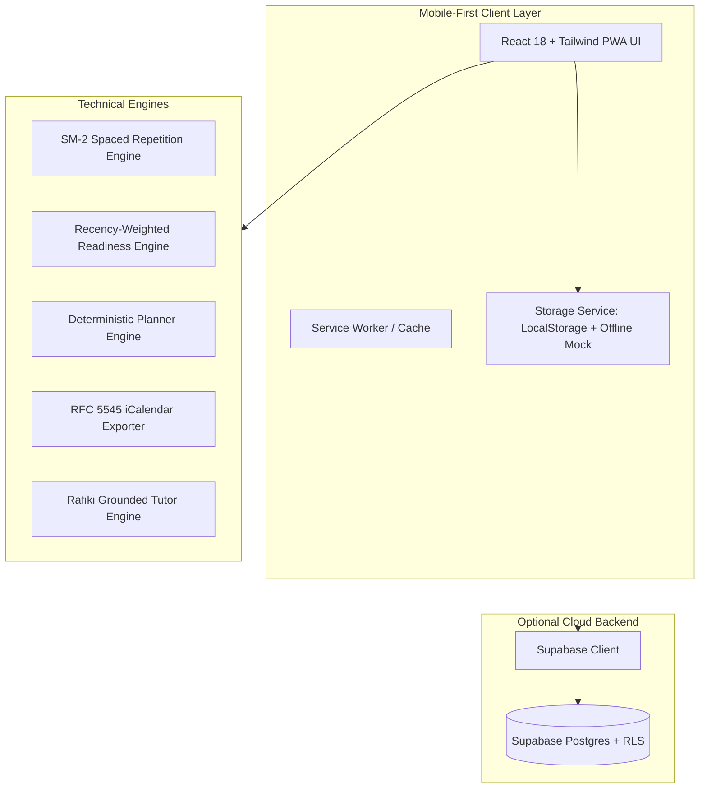

# Msingi 🌍 | AZ-900 Prep for Africa

> **Msingi** (*"Foundation"* in Swahili) is an unofficial, mobile-first Progressive Web App (PWA) designed to empower learners across Africa to prepare for and pass the **Microsoft Azure Fundamentals (AZ-900)** exam. Built with heart for the **#1MillionDevs Vibe Coding Hackathon**.

---

## 🏛️ Mandatory Disclaimer & Trademark Notice

> **Important**: Msingi is an **unofficial** study tool. It is **not** affiliated with, sponsored by, or endorsed by Microsoft Corporation. **AZ-900** is a registered exam administered by Microsoft.
>
> All trademarks, service marks, and trade names (including Microsoft, Azure, and Microsoft 365) are the property of their respective owners. Msingi uses plain-text references solely for educational identification and curriculum mapping.
>
> \* **Readiness Score Notice**: The readiness score provided by Msingi is an educational estimation based on active recall performance and does not guarantee exam passage.

---

## 💡 The Problem & The Learner Story

Cloud computing is the backbone of Africa's rapid technological renaissance—from fintech unicorns in Lagos and Nairobi to logistics hubs in Mombasa and agritech in Accra. Yet, millions of aspiring African developers encounter three critical friction points when preparing for cloud certifications:

1. **Abstract, Western-Centric Analogies**: Traditional training references municipal snowplows, baseball ticketing, or American toll roads. Abstract concepts become far more intuitive when grounded in relatable scenarios: M-Pesa transaction spikes, danfo/matatu logistics, or market stall electricity tokens.
2. **Bandwidth & Data Cost Realities**: High data costs and intermittent network connectivity make heavy streaming video tutorials impractical. Learners need an offline-first PWA that functions seamlessly on low-end smartphones.
3. **Pervasive Brain Dumps & Outdated Materials**: Unofficial study resources frequently peddle outdated questions or violate certification NDAs. Learners need 100% original, verified questions mapped strictly to Microsoft Learn.

---

## ⚡ Architecture Overview



---

## ✨ Key Features

### 1. 🎯 Recency-Weighted Readiness Score
- **0–100% Score Engine**: Weighs your last 50 attempts with linear recency weighting so recent progress and recent mistakes accurately reflect current exam readiness.
- **Official Domain Normalization**: Calibrated according to the July 20, 2026 skills outline:
  - *Describe cloud concepts* (25–30%)
  - *Describe Azure architecture and services* (35–40%)
  - *Describe Azure management and governance* (30–35%)
- **Dynamic Heatmap**: Real-time red/amber/green calibration across all 15 syllabus topics.

### 2. 🧠 SM-2 Spaced Repetition Flashcard Coach
- **SuperMemo SM-2 Engine**: Dynamically calculates ease factors, intervals, and lapses for optimal recall.
- **African Analogies**: Every flashcard pairs technical definitions with memorable analogies (e.g., Shared Responsibility compared to Nairobi apartment tenancy; CapEx vs OpEx compared to petrol generators vs prepaid power tokens).
- **Missed Quiz Question Auto-Capture**: Any question missed during a quiz is automatically transformed into a custom flashcard for targeted recall.

### 3. 📅 Deterministic Study Planner & Calendar Export
- **Personalized Schedule**: Distributes syllabus topics and review sessions across your available days and weekly study hours.
- **One-Click Calendar Export (.ics)**: Generates standard RFC 5545 `.ics` calendar files compatible with Google Calendar, Apple Calendar, and Microsoft Outlook.
- **Dynamic Re-planning**: Re-calculates your remaining study tasks from "Today" based on current weak areas.

### 4. 🤖 Rafiki: Grounded AI Study Buddy
- **Multi-lingual Context**: Supports English, Kiswahili, Sheng, and Nigerian Pidgin.
- **Zero-Hallucination Grounding**: Tied directly to official Microsoft Learn syllabus topics and real-world African analogies.
- **Web Speech Synthesis**: Integrated text-to-speech for accessible, hands-free audio listening.

### 5. 🛡️ Content Accuracy & Zero-Dump Pipeline
- **100% Original Scenarios**: SACCO cooperative banking, Mombasa cargo tracking, Lagos payment gateways.
- **Distractor Scrutiny**: Every incorrect option contains a documented rationale explaining why it is plausible in production yet incorrect in this specific context.
- **Direct Documentation Links**: Every topic is linked directly to official Microsoft Learn documentation.

---

## 🚀 Getting Started

### Prerequisites
- Node.js (v18 or higher)
- npm or pnpm

### Quick Setup

```bash
# 1. Clone the repository
git clone https://github.com/your-org/msingi.git
cd msingi

# 2. Install dependencies
npm install

# 3. Start the development server
npm run dev
```

Visit `http://localhost:5173` in your browser.

### Optional: Supabase Sync Setup
Msingi runs 100% locally out-of-the-box using client-side storage. To optionally connect a Supabase backend:

1. Copy `.env.example` to `.env`:
   ```bash
   cp .env.example .env
   ```
2. Fill in your `VITE_SUPABASE_URL` and `VITE_SUPABASE_ANON_KEY`.
3. Apply migrations in `supabase/migrations/` to your Postgres instance.

---

## 📂 Project Structure

```
Msingi/
├── docs/                       # Verification standards & plan documentation
│   ├── ACCURACY.md             # Content verification pipeline
│   ├── COVERAGE.md             # Syllabus coverage matrix
│   ├── DECISIONS.md            # Architecture decision records
│   ├── DEMO_SCRIPT.md          # 2-minute judge walkthrough script
│   ├── FACT_CHECK.md           # Scrutiny log & source verification notes
│   └── PLAN.md                 # Implementation roadmap
├── prompts/                    # Auditing & Rafiki system prompts
│   ├── content-verifier.md     # Two-stage content auditor prompt
│   ├── question-generator.md   # Grounded question authoring prompt
│   └── study-buddy.md          # Rafiki AI persona & analogies
├── src/
│   ├── components/             # Reusable UI components
│   │   ├── common/             # Header, Navbar, Footer, ReportModal
│   │   └── onboarding/         # Onboarding diagnostic flow
│   ├── data/                   # Verified syllabus and seed data
│   │   ├── az900-syllabus.ts   # July 20, 2026 outline mapping
│   │   ├── seed-flashcards.ts  # Verified flashcards with African analogies
│   │   └── seed-questions.ts   # Original verified practice questions
│   ├── lib/                    # Core technical engines
│   │   ├── ics.ts              # RFC 5545 calendar exporter
│   │   ├── planner-engine.ts   # Deterministic study scheduler
│   │   ├── readiness.ts        # Recency-weighted readiness engine
│   │   ├── sm2.ts              # SuperMemo SM-2 spaced repetition
│   │   ├── storage.ts          # StorageService with offline-first fallback
│   │   └── supabase.ts         # Optional Supabase client
│   ├── pages/                  # Main views
│   │   ├── AboutPage.tsx       # Mission, compliance, scoring guide
│   │   ├── AccuracyPage.tsx    # Public coverage matrix & verification
│   │   ├── FlashcardsPage.tsx  # SM-2 card coach with flip animation
│   │   ├── HomeDashboard.tsx   # Readiness gauge & topic heatmap
│   │   ├── PlannerPage.tsx     # Deterministic study planner & checklist
│   │   ├── QuizPage.tsx        # Smart quiz builder & 40Q timed mock
│   │   └── RafikiPage.tsx      # Grounded AI tutor
│   ├── types/                  # TypeScript interfaces
│   ├── App.tsx                 # Root application
│   ├── index.css               # Tailwind CSS styles
│   └── main.tsx                # Entrypoint
├── package.json
├── tailwind.config.js
└── vite.config.ts
```

---

## 📜 License & Compliance

Crafted with ❤️ for African learners in the **#1MillionDevs Vibe Coding Hackathon**. Released under the MIT License.

