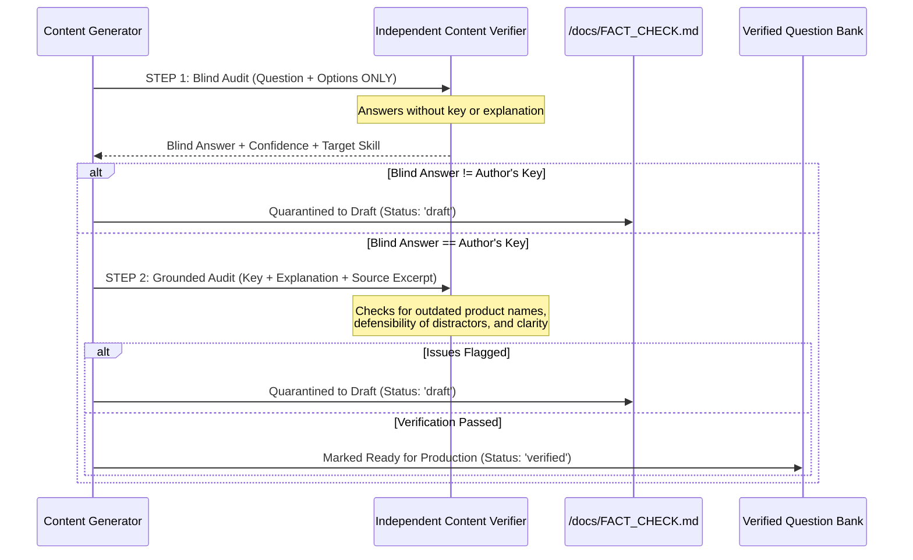

# Msingi Content Accuracy & Verification Pipeline

> **Guiding Principle**: An exam preparation tool is only as valuable as the factual accuracy of its curriculum. Msingi implements a zero-hallucination, dual-stage verification pipeline grounded directly in Microsoft Learn documentation (effective July 20, 2026).

---

## 1. Zero Dump Policy & Originality

Msingi strictly forbids the use or reproduction of leaked exam questions ("exam dumps"). 
- All questions, distractors, scenarios, and flashcards are **100% original content**.
- Scenarios are grounded in authentic African enterprise use cases (e.g. mobile money scaling, agricultural supply chain tracking in Mombasa, fintech transactions in Lagos, SACCO digitization).
- All technical facts, service limits, architectures, and capabilities are cross-referenced directly against official Microsoft Learn documentation pages.

---

## 2. Two-Stage Independent Verification Pipeline

Every item authored for Msingi passes through a strict, decoupled verification protocol:

### Step 1: Blind Assessment
The auditor receives **only** the question stem and the four options. It is not provided the author's answer or explanation.
- If the auditor's blind answer diverges from the author's intended key, the question is immediately flagged for ambiguity.

### Step 2: Grounded Audit
The auditor receives the author's key, explanation, wrong-option notes, and the official source documentation snippet. It evaluates:
1. Is every sentence in the explanation supported by Microsoft Learn?
2. Could any other option be defended as correct under alternative interpretations?
3. Are all product names modern (e.g. **Microsoft Entra ID** instead of Azure AD)?
4. Is the language accessible and unambiguous for English-as-a-second-language learners?

---

## 3. High-Scrutiny Watchlist

Specific Azure concept boundaries are frequently confused by beginners. The following topics receive mandatory manual review:
1. **Azure Policy vs RBAC vs Resource Locks**: Enforcing compliance (Policy) vs user authorization (RBAC) vs accidental deletion prevention (Locks).
2. **Availability Zones vs Availability Sets vs Region Pairs**: Datacenter resilience vs rack fault/update domains vs geographic cross-region disaster recovery.
3. **Storage Redundancy (LRS vs ZRS vs GRS vs GZRS)**: Single datacenter vs multi-zone vs multi-region asynchronous replication.
4. **Azure Advisor vs Service Health vs Azure Monitor**: Proactive best-practice guidance vs global platform incident status vs observability telemetry and alerts.
5. **Microsoft Purview vs Defender for Cloud**: Data governance/classification vs cloud workload posture and threat protection.
6. **Microsoft Entra ID vs Microsoft Entra Domain Services**: Modern cloud identity protocols (OAuth/SAML) vs legacy managed Kerberos/LDAP.

---

## 4. Unofficial Status & Disclaimers

Msingi complies strictly with Microsoft credentialing and trademark guidelines:
- Prominently displays on every screen: *"Msingi is an unofficial study tool. Not affiliated with or endorsed by Microsoft. AZ-900 is a Microsoft exam."*
- Readiness scores are explicitly designated as *"an estimate, not a guarantee of exam success."*
- Zero use of proprietary logos, marks, or certification badges.

