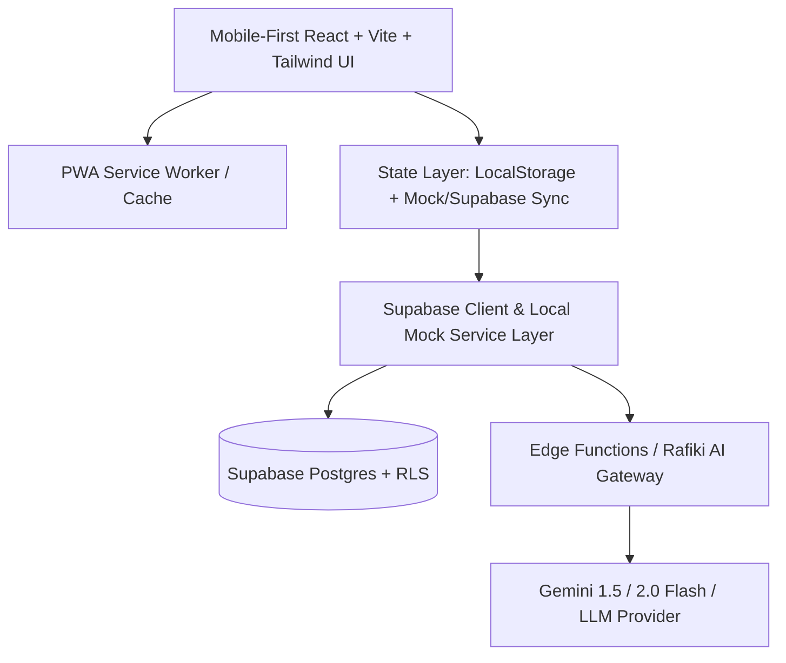

# Msingi - Implementation Plan

**Msingi** ("Foundation" in Swahili) is an unofficial, mobile-first Progressive Web App (PWA) designed to empower learners across Africa to prepare for and pass the Microsoft Azure Fundamentals (AZ-900) exam. Built for the **#1MillionDevs Vibe Coding Hackathon**.

---

## 1. Architecture Overview



- **Frontend Core**: React 18 / 19, TypeScript, Vite, Tailwind CSS, Lucide Icons, Framer Motion, Recharts, canvas-confetti.
- **PWA & Offline Capability**: Service worker caching and offline-first IndexedDB/LocalStorage for flashcards and quiz state, ensuring smooth learning in low-bandwidth environments.
- **Backend & Storage**: Supabase (Postgres with Row Level Security, Auth, Edge Functions) with a zero-friction **Local Mock Fallback** enabling the entire app to run offline or without API keys.
- **AI Study Buddy ("Rafiki")**: Streaming contextual tutor with prompt injection of verified Microsoft Learn syllabus text, supporting English, Kiswahili, Sheng, and Nigerian Pidgin.

---

## 2. Project Folder Structure

```
Msingi/
├── docs/
│   ├── PLAN.md                 # Implementation roadmap
│   ├── DECISIONS.md            # Architecture decision records
│   ├── ACCURACY.md             # Content verification pipeline documentation
│   ├── COVERAGE.md             # Syllabus coverage matrix
│   ├── FACT_CHECK.md           # Scrutiny log & source verification notes
│   └── DEMO_SCRIPT.md          # 2-minute judge walkthrough script
├── prompts/
│   ├── content-verifier.md     # Strict AZ-900 two-stage auditor prompt
│   ├── study-buddy.md          # Rafiki AI prompt with African analogies
│   └── question-generator.md   # Grounded question authoring prompt
├── public/
│   ├── favicon.svg
│   ├── manifest.json           # PWA web app manifest
│   └── icons/
├── src/
│   ├── assets/
│   ├── components/
│   │   ├── layout/             # Header, NavigationBar, Footer (with compliance disclaimer)
│   │   ├── common/             # Button, Card, Badge, Modal, Disclaimer, StreakConfetti
│   │   ├── quiz/               # QuestionCard, OptionItem, FeedbackPanel, QuizTimer
│   │   ├── flashcards/         # FlashcardDeck, CardFlip, SM2RatingControls
│   │   ├── readiness/          # RadialGauge, DomainBar, TopicHeatmap, TrendLine
│   │   ├── planner/            # CalendarView, TaskChecklist, DayHoursGrid, IcsExport
│   │   ├── buddy/              # RafikiChatDrawer, QuickChips, LanguageSelector
│   │   └── onboarding/         # DiagnosticQuiz, DatePickerStep, HoursStep
│   ├── data/
│   │   ├── az900-syllabus.ts   # Exact July 20, 2026 domains, skills, topics
│   │   ├── seed-questions.ts   # Original verified practice questions
│   │   └── seed-flashcards.ts  # Original verified flashcards with African analogies
│   ├── hooks/                  # useAuth, useQuiz, useFlashcards, useReadiness, useRafiki
│   ├── lib/
│   │   ├── supabase.ts         # Supabase client + Local Mock Provider switch
│   │   ├── sm2.ts              # SM-2 Spaced Repetition engine
│   │   ├── readiness.ts        # Recency-weighted readiness calculation engine
│   │   ├── planner-engine.ts   # Deterministic study schedule generator
│   │   └── ics.ts              # RFC 5545 calendar export generator
│   ├── pages/
│   │   ├── HomeDashboard.tsx   # Readiness score, heatmap, next best action
│   │   ├── QuizPage.tsx        # Smart quiz builder & mock exam
│   │   ├── FlashcardsPage.tsx  # Spaced repetition card coach
│   │   ├── PlannerPage.tsx     # Study schedule & checklist
│   │   ├── RafikiPage.tsx      # Fullscreen or drawer AI buddy
│   │   ├── AccuracyPage.tsx    # Public coverage matrix & verification pipeline
│   │   ├── OnboardingPage.tsx  # 3-step setup & 10-question diagnostic
│   │   └── AboutPage.tsx       # Unofficial disclaimer, mission, scoring guide
│   ├── types/                  # Database and domain interfaces
│   ├── App.tsx
│   ├── index.css
│   └── main.tsx
├── supabase/
│   └── migrations/             # SQL schema, RLS policies, seed scripts
├── .env.example
├── package.json
├── tailwind.config.js
├── vite.config.ts
└── README.md
```

---

## 3. Data Model & Database Schema

Designed to be cert-agnostic (`certifications` table with `domains` and `topics`):

1. **`certifications`**: `id`, `code` (e.g. `AZ-900`), `title`, `description`, `skills_outline_date` (`2026-07-20`).
2. **`domains`**: `id`, `certification_id`, `name`, `weight_min_pct`, `weight_max_pct`, `slug`, `order_index`.
3. **`topics`**: `id`, `domain_id`, `title`, `slug`, `outline_skill`, `source_url`.
4. **`questions`**: `id`, `topic_id`, `stem`, `type` (`single`|`multiple`|`boolean`), `options` (jsonb), `correct` (jsonb), `explanation`, `wrong_option_notes` (jsonb), `difficulty`, `outline_skill`, `source_url`, `status` (`draft`|`verified`), `verified_at`, `review_notes`.
5. **`flashcards`**: `id`, `topic_id`, `front`, `back`, `african_analogy`, `outline_skill`, `source_url`, `status`, `verified_at`.
6. **`card_progress`**: `id`, `user_id`, `card_id`, `ease_factor`, `interval_days`, `due_at`, `lapses`, `repetitions`.
7. **`attempts`**: `id`, `user_id`, `question_id`, `selected` (jsonb), `is_correct`, `time_ms`, `created_at`.
8. **`mock_exams`**: `id`, `user_id`, `score_pct`, `domain_breakdown` (jsonb), `duration_seconds`, `completed_at`.
9. **`study_plans`**: `id`, `user_id`, `exam_date`, `hours_per_day` (jsonb), `created_at`.
10. **`plan_tasks`**: `id`, `plan_id`, `date`, `topic_id`, `task_type`, `estimated_minutes`, `is_completed`.
11. **`chat_sessions`**: `id`, `user_id`, `language`, `messages` (jsonb), `updated_at`.
12. **`content_reports`**: `id`, `user_id`, `content_type`, `content_id`, `issue_text`, `created_at`.

---

## 4. Milestone Plan & Time Budget

| Milestone | Deliverables | Target Time | Priority |
|---|---|---|---|
| **M1: Foundation** | Vite scaffold, Tailwind, Navigation shell, 3-step onboarding, Supabase migrations + Mock Local Storage, Guest mode | 1.5 hrs | P0 |
| **M2: Smart Quiz Builder** | Quiz modes (domain, topic, weak, 40-q timed mock), instant explanation, wrong note breakdowns, confetti streak, report issue | 2.0 hrs | P0 |
| **M3: Content Pipeline** | July 2026 AZ-900 syllabus dataset (3 domains, 3-5 original verified questions/skill, 2-3 flashcards/skill), verifier prompt, `/docs/ACCURACY.md`, `/docs/COVERAGE.md`, `/docs/FACT_CHECK.md` | 2.5 hrs | P0 |
| **M4: Flashcard Coach** | SM-2 spaced repetition, flip card, mobile swipe, keyboard shortcuts, wrong quiz auto-add | 1.5 hrs | P0 |
| **M5: Readiness Tracker** | Recency-weighted 0-100 score engine, radial gauge, domain progress bars, per-topic heatmap, score trend, next-best-action | 1.5 hrs | P0 |
| **M6: Study Planner** | Deterministic study planner, 7-day grid, checklist/calendar, re-plan from today, .ics export | 1.5 hrs | P1 |
| **M7: Rafiki AI Buddy** | Grounded study buddy with African analogies, Kiswahili/Sheng/Pidgin, quick-action chips, rate-limited edge fallback | 1.5 hrs | P0 |
| **M8: Polish & Docs** | WCAG AA contrast, skeletons/empty states, `/docs/DEMO_SCRIPT.md`, README with Mermaid architecture and learner story, live demo | 1.5 hrs | P0 |

---

## 5. Compliance & Accuracy Guardrails

1. **Mandatory Disclaimer**: Every footer and `/about` displays:
   > *"Msingi is an unofficial study tool. Not affiliated with or endorsed by Microsoft. AZ-900 is a Microsoft exam."*
2. **Readiness Disclaimer**: *"The readiness score is an estimate, not a guarantee of exam success."*
3. **No Microsoft Logos**: Plain text "Azure" only; custom African-inspired SVG icons.
4. **Originality**: 100% original scenarios (SACCO, M-Pesa, Lagos fintech, logistics in Mombasa). No exam dumps. Grounded strictly in Microsoft Learn.

